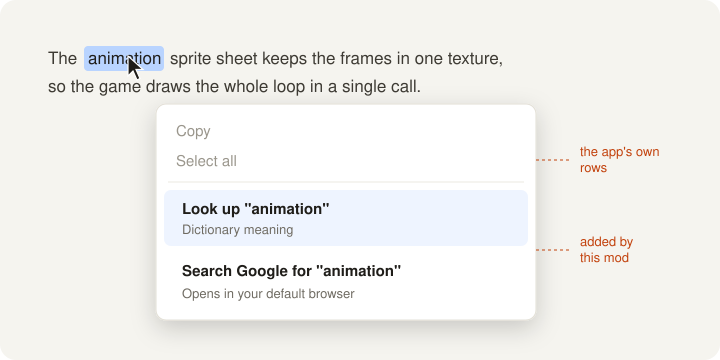
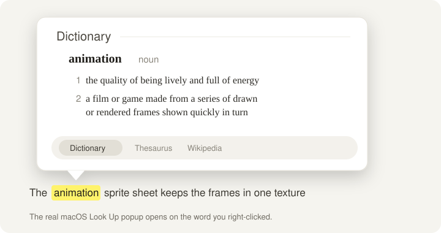
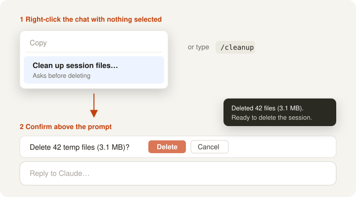

# d2d-claude-utility-mod

A small Claude Code mod that adds three handy actions to the Claude desktop app's chat:

- **Look up** a selected word in the real macOS Look Up popup (dictionary, thesaurus and more).
- **Search Google** for selected text in your default browser.
- **Clean up session files**: empty the current session's temp and cache files before you delete the session, always asking first.

The images below are illustrations of what you'll see.

## Features

### Look up and Search Google on selected text

Select a word or some text in the chat, then right-click it. The mod adds two rows to the menu, each showing the words you selected (long selections are shortened in the label):



**Look up "…"** opens macOS's own Look Up popup on the word you right-clicked, the same one you get in Safari or Chrome:



**Search Google for "…"** opens a Google search for your full selection in your Mac's default browser.

### Clean up session files

Right-click the chat with **nothing selected** and choose **Clean up session files…**, or type `/cleanup`. The mod counts the files first and asks above the prompt before anything is deleted:



It empties three folders that belong to the current session only:

| Folder | What's in it |
| --- | --- |
| The session's scratchpad | Temporary files Claude wrote while working |
| Background task output | Logs from commands Claude ran in the background |
| Saved tool outputs | Copies of large tool results kept for the session |

The folders themselves stay, so the session keeps working. Your project files and the conversation itself are never touched. Each folder is checked to belong to the current session (by its session id) before anything in it is removed.

## Install

At the prompt of a terminal session:

```
/plugin install d2d-claude-utility-mod --marketplace bhavinpanara22/d2d-claude-utility-mod
```

Or from a shell:

```bash
claude plugin install d2d-claude-utility-mod --marketplace bhavinpanara22/d2d-claude-utility-mod
```

In the desktop app, where `/plugin` doesn't run: click **+** next to the prompt box, then **Plugins**, **Add marketplace** with `bhavinpanara22/d2d-claude-utility-mod`, then **Add plugin**.

Answer `y` to add the marketplace, then choose the user scope so the mod loads in every session.

## Requirements

- **The Claude desktop app** for the right-click menu. `/cleanup` also works in a terminal session.
- **macOS** for Look Up. Search Google and the cleanup work wherever the mod runs.
- **Accessibility permission for Claude** (System Settings → Privacy & Security → Accessibility) for the Look Up popup. Without it, the mod shows the dictionary definition in a row above the prompt instead, and says why.

## How Look Up works

macOS only opens its Look Up popup for an app that asks from inside its own window, or for the **Control + Command + D** shortcut, which looks up the word under the pointer. A mod runs outside the app's window, so it uses the shortcut:

1. When you right-click, the mod notes where the pointer is, over the word you clicked.
2. When you pick **Look up**, the menu closes, the pointer moves back over the word, the shortcut is pressed, and the pointer returns to where you left it. You'll see a brief flicker.

The lookup runs entirely on your Mac through the built-in Dictionary. Nothing is sent anywhere.

## Development

The code is in [`hooks/register.tsx`](hooks/register.tsx) and the tests are in [`hooks/register.test.tsx`](hooks/register.test.tsx).

Run the checks and tests from this folder:

```bash
claude plugin validate .
```

```bash
claude plugin test .
```

To try a change without installing it, start Claude with the folder loaded:

```bash
claude --plugin-dir /path/to/d2d-claude-utility-mod
```
